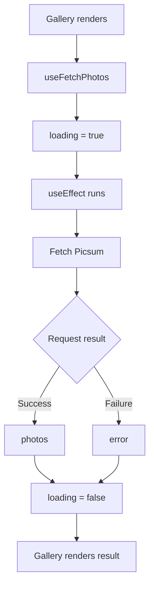

# Celebrare Photo Gallery

A responsive React photo gallery built for the Celebrare Frontend Intern Pre-Screening Assignment.

**Tech:** React · Vite · Tailwind CSS · Picsum Photos API

## Features

- Fetches 30 photos from Picsum
- Loading and error states
- Responsive 1 / 2 / 4-column grid
- Real-time author search without additional API calls
- Favourite/unfavourite photos
- Favourites persisted in `localStorage`
- `useFetchPhotos` custom hook
- `useReducer`, `useCallback`, and `useMemo`

---

## Project Structure

```text
src/
├── components/
│   ├── Gallery.jsx
│   ├── PhotoCard.jsx
│   └── SearchBar.jsx
├── hooks/
│   └── useFetchPhotos.js
├── reducers/
│   └── favouritesReducer.js
├── App.jsx
├── main.jsx
└── index.css
```

---

# How It Works

## 1. Fetching Photos

The API call lives inside `useFetchPhotos.js`.



The hook uses:

```js
useEffect(() => {
  const fetchPhotos = async () => {
    // Fetch photos from Picsum
  };

  fetchPhotos();
}, []);
```

The empty dependency array means the effect has no dependencies. In a production build, it runs when the component mounts rather than every time the component renders.

React Strict Mode can run effects an extra time during development, so an additional initial request may appear while developing.

The photos are stored in React state:

```js
const [photos, setPhotos] = useState([]);
```

Once the API responds:

```js
const data = await response.json();
setPhotos(data);
```

While the request is pending, a Tailwind CSS spinner is displayed. Once the request completes, `loading` becomes `false` and the gallery renders.

---

## 2. Search

`Gallery` owns the search state:

```text
searchTerm
    ↓
handleSearch
    ↓
SearchBar
```

`SearchBar` receives:

```jsx
<SearchBar
  searchTerm={searchTerm}
  onSearch={handleSearch}
/>
```

`searchTerm` is the current text, while `onSearch` is the `handleSearch` function from `Gallery`.

This keeps the state in `Gallery` while `SearchBar` is only responsible for displaying the input.

### Search does NOT call the API again

The photos are fetched once and stored in `photos`.

Search filters that existing array:

```js
const filteredPhotos = useMemo(() => {
  return photos.filter((photo) =>
    photo.author.toLowerCase().includes(searchTerm.toLowerCase())
  );
}, [photos, searchTerm]);
```

The important distinction:

- `photos` = data already fetched from Picsum
- `searchTerm` = text typed by the user
- `.filter()` = selects matching photos
- `useMemo` = caches the result until `photos` or `searchTerm` changes

There is no `fetch()` or API request inside the search logic.

So changing `searchTerm` recalculates the filtered list without contacting Picsum again.

---

## 3. Favourites with `useReducer`

The reducer has one action:

```text
TOGGLE_FAVOURITE
```

If the photo is already a favourite:

```js
if (state.includes(photoId)) {
  return state.filter((id) => id !== photoId);
}
```

This means:

> "It's already a favourite, so remove it."

Otherwise:

```js
return [...state, photoId];
```

means:

> "It's not a favourite yet, so add it."

I used `useReducer` because the assignment specifically requires reducer-based favourite state. It also keeps the state transition logic in one place and returns a new state array for each action.

Favourites are persisted to `localStorage`, so they survive a page refresh.

---

## 4. `useCallback`

The search handler is:

```js
const handleSearch = useCallback((event) => {
  setSearchTerm(event.target.value);
}, []);
```

`useCallback` keeps the same function reference between renders unless its dependencies change.

The favourite handler is also wrapped in `useCallback`.

These hooks aren't strictly necessary for a gallery this small, but they demonstrate the React performance techniques specifically requested by the assignment.

---

## 5. `useMemo`

The filtered photos use:

```js
const filteredPhotos = useMemo(() => {
  return photos.filter((photo) =>
    photo.author.toLowerCase().includes(searchTerm.toLowerCase())
  );
}, [photos, searchTerm]);
```

This caches the filtered array until either `photos` or `searchTerm` changes.

Again, removing `useMemo` wouldn't break the application. It is used here because the assignment specifically asks for it and because it demonstrates derived-state memoisation.

---

# Responsive Layout

The gallery uses:

```jsx
<div className="grid grid-cols-1 gap-6 sm:grid-cols-2 lg:grid-cols-4">
```

```text
grid-cols-1     → 1 column on mobile
sm:grid-cols-2  → 2 columns on tablets
lg:grid-cols-4  → 4 columns on desktop
```

This directly satisfies the assignment's responsive-grid requirement.

Each image uses:

```text
h-64         → fixed 256px image height
w-full       → fills the card width
object-cover → crops the image instead of stretching it
```

---

# Running Locally

```bash
npm install
npm run dev
```

For a production build:

```bash
npm run build
```

---

# Video Walkthrough

The main points covered in the recording are:

1. **Custom hook** — fetching, loading and error states
2. **Search** — filtering the existing array without another API request
3. **Reducer** — toggling favourite IDs
4. **`useCallback`** — stable event-handler references
5. **`useMemo`** — caching filtered photos
6. **Responsive Tailwind grid**
7. **`localStorage`** — persisting favourites

The implementation intentionally stays close to the assignment requirements without adding unnecessary features.